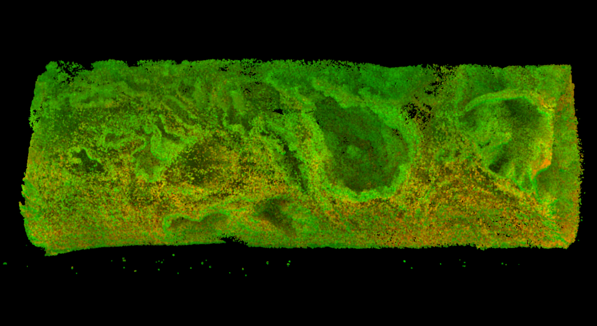

# Adaptive sampling for 3D biopsies

This project provides a scalable pipeline for converting large 3D microscopy volumes stored in HDF5 into light-weight colored point clouds using tile-based processing and adaptive sampling. The system is designed for datasets that exceed RAM capacity and supports parallel processing, automatic normalization, and adaptive density/information sampling. The final colored point cloud is meant to be a highly compressed representation compatible with existing end-to-end algorithms for geometric deep learning.

## Key Features

* **Tiling**: Large volumes are processed by chunks (`block_size`) using h5py "lazy loading".
* **Multi-threading**: Tiles are processed in individual threads and results are merged in the main one.
* **Auto-Normalization**: Automatic background subtraction and percentile normalization before processing.
* **Adaptive Density Sampling**: Sigmoid function determines tile density (n points to sample per tile) based on mesh surface area.
* **Adaptive Information Sampling**: Informaiton-based sampling based on Sobel gradient, mesh surface, mesh curvature (to be tested), and intensity maps (to be implemented).

## Installation

### 1) Clone repository
```bash
git clone https://github.com/alpnboy/adaptive_sampling_3D.git  
cd adaptive_sampling
```

### 2) Create new environment and install requirements

```bash
conda create -n 3DxNenv python=3.10  
conda activate 3DxNenv  
pip install -r requirements.txt
```

Python venvs can be used instead of conda if the host system has a suitable Python version (>=3.10).
```bash
# On Linux/OSX:
python -m venv .venv
source .venv/bin/activate
pip install -r requirements.txt
```

## Pipeline overview
```text
H5 Volume  
↓  
Whole slide estimates (intensities cutoffs, percentiles, ...)  
↓  
Tile-based Processing (normalization, meshing, ...)  
↓  
Adaptive Sampling  
↓  
Tile Colored Point Cloud  
↓  
Merged Global Point Cloud  
↓  
PLY Export
```

## Project structure

```text
adaptive_sampling_3D/              # Root
├── data/                       
│   ├── raw_h5/                 # Input H5 volumes
│   └── results/                # Output colored point clouds
├── adaptive_sampling_3D/          
│   ├── core/                   # Mesh, PointCloud, Volume logic
│   ├── io/                     # Input/Output operations
│   └── stages/                 # Processing stages
└── create_pcd_dataset.py       # Main entry point
```


## Usage guide

The `create_pcd_dataset.py` file is the main entry point for the pipeline. It orchestrates the reading, processing, and writing of colored point clouds from H5 images.

### Command Example
```bash
python -m adaptive_sampling_3D.create_pcd_dataset --input_dir ./data/raw_h5 --result_dir ./data/results --multi_thread True --num_workers 8 --block_size 500 500 500
```

### Configuration / Parameters
```text
- `--input_dir`: directory with input H5 files
- `--result_dir`: output directory for PLY files
- `--block_size`: size of tile blocks in z, y, x
- `--multi_thread`: True/False
- `--num_workers`: number of threads
```
## Example Output

The pipeline produces colored point clouds in `.ply` format. These can be visualized using:

- MeshLab  
- Open3D  
- CloudCompare

Point clouds can appear flat without normals and rendering. For best visualization open the .ply file with CloudCompare, increase point size to 2-3, and enable "SSAO Shader" under "Display/Shaders & Filters".



## Requirements

### Input HDF5 Structure

At present, the pipeline expects each `.h5` file to contain **two datasets** of shape (z, y, x), each representing a volumetric image channel.

Example:

```text
file.h5
├── channel_0
├── channel_1
```

### Packages

The project requires Python ≥ 3.10 and the following main libraries:

- numpy
- h5py
- open3d
- scikit-image
- scipy
- tqdm

All dependencies are listed in `requirements.txt`.

## Future developments

### User:
- Integrate information-based sampling using local intensities map and surface curvature.
- Enable user specified cloud density and target channel/s.
- Expand reader to OME-ZAR images.

### Performance:
- Optimize cpu operations (meshing, gradient estimation, ...).
- C++ parallel processing implementation with Python bindings.
